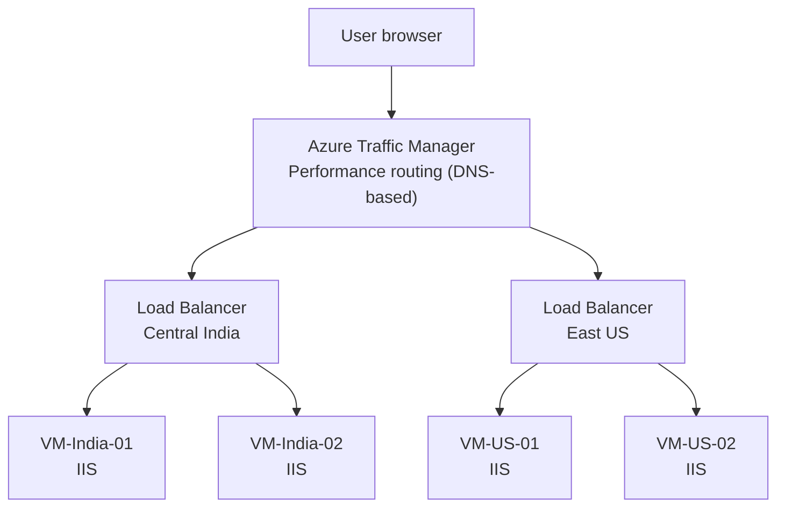

# Multi-Region Web Deployment with Azure Traffic Manager and Load Balancers

## 📌 Project Overview
In this project, I deployed a web application across two Azure regions, Central India and East US. In each region, two Windows Server VMs running IIS sit behind an Azure Load Balancer. Azure Traffic Manager uses performance-based routing to send each user to the closest healthy region, and it redirects users to the other region if the first one stops responding.

---

## 🏗️ Architecture

| Region | VNet | Address space | VMs |
| :--- | :--- | :--- | :--- |
| Central India | `VNet-Region-A` | `10.1.0.0/16` | `VM-India-01`, `VM-India-02` |
| East US | `VNet-Region-B` | `10.2.0.0/16` | `VM-US-01`, `VM-US-02` |

---

## 🛠️ Components Deployed
*   **Virtual Networks:** `VNet-Region-A` in Central India and `VNet-Region-B` in East US, with non-overlapping address ranges.
*   **Global VNet Peering:** Peering between the two VNets, in both directions, so the regions are connected privately.
*   **Virtual Machines:** Four Windows Server VMs, two per region, with no public IP addresses.
*   **Web server:** IIS installed on all four VMs, each serving its own test page.
*   **Network Security Groups:** An NSG for each VM, with an inbound rule allowing HTTP (port 80) and a rule allowing the `AzureLoadBalancer` service tag.
*   **Azure Load Balancers:** One per region, with the regional VMs in the backend pool and a TCP port 80 health probe.
*   **Azure Traffic Manager profile:** Performance routing method, with the two regional load balancers as its endpoints.

---

## 🧪 Testing
Each VM serves a different page so I could see which server answered:

| VM | Page content |
| :--- | :--- |
| `VM-India-01` | `Welcome to India Region VM1` |
| `VM-India-02` | `Welcome to India Region VM2` |
| `VM-US-01` | `Welcome to US Region VM1` |
| `VM-US-02` | `Welcome to US Region VM2` |

| Step | Condition | Result in browser |
| :--- | :--- | :--- |
| 1 | Both regions running | `Welcome to India Region VM1` (closest region) |
| 2 | India VMs stopped | `Welcome to US Region VM1` (Traffic Manager moved to the East US endpoint) |

Traffic Manager works at the DNS level: when the health probes detect that an endpoint is down, it stops returning that endpoint in DNS answers. The change takes effect after the probe interval and the DNS TTL.

---

## ℹ️ Status
Built hands-on in the Azure portal using a free trial subscription.
